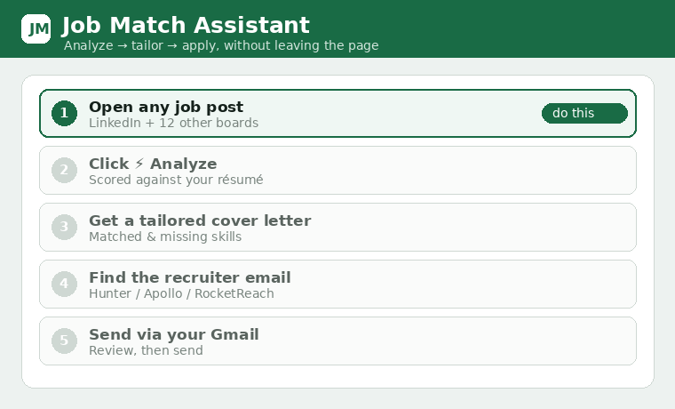
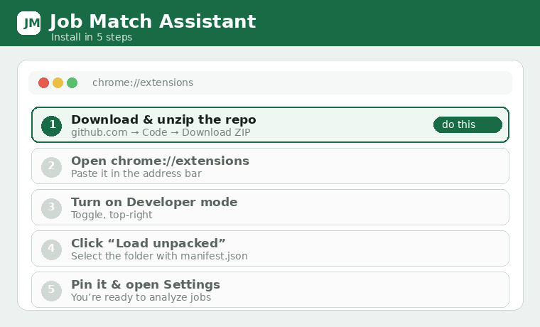
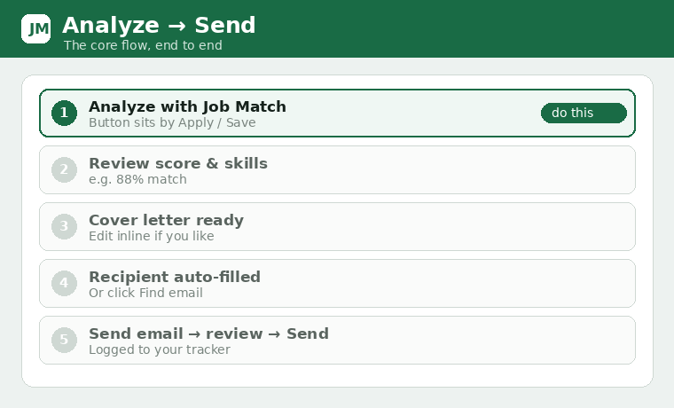

# Job Match Assistant

**Live page:** https://ramcala.github.io/job-match-assistant/  ·  **Download:** [job-match-assistant.zip](job-match-assistant.zip) (ready to load unpacked)

A Chrome extension that analyses job postings against your résumé, writes a tailored cover letter,
finds the recruiter's email, and lets you **send the application over Gmail** (or save a draft) —
without leaving the job page. It works on LinkedIn and a dozen other job boards, pulls jobs out of
your Gmail job‑alert inbox, and keeps a local applied‑jobs tracker.

> Bring your own keys. Everything runs in your browser; your résumé and job text go only to the
> provider you pick (OpenAI, or your own ChatGPT/Gemini tab), and email is sent only through your
> own Gmail with your explicit confirmation.

## Features

- **Match analysis** — scores a job against your résumé, lists matched/missing skills, and writes a
  ready‑to‑send cover letter. Four modes: local keyword matching (no key), OpenAI API, or your
  logged‑in ChatGPT / Gemini browser session.
- **Analyze anywhere** — an inline **⚡ Analyze** button on LinkedIn job pages (next to Apply/Save)
  plus a floating button on other boards; also reads the "About the company" and "People you can
  reach out to" sections for richer cover letters.
- **Send the application** — review‑then‑send over Gmail (primary), or save a draft. Recipient is
  auto‑filled from any email in the post; otherwise use **Find email**.
- **Find email** — Hunter.io, Apollo.io, or RocketReach, with results cached locally so you never
  pay for the same lookup twice.
- **LinkedIn Easy Apply** — optional autofill that stops rather than guess, with a "remember my
  answers" learner for new screening questions.
- **From your inbox** — pulls jobs out of LinkedIn/Indeed/Naukri/etc. job‑alert emails in Gmail.
- **Job boards** — one search bar opens LinkedIn, Wellfound, Instahyre, Naukri, Indeed, Glassdoor,
  Cutshort, Hirist, Foundit, Work at a Startup, RemoteOK, Remote.co pre‑filled (or all at once).
- **Applied tracker** — every application logged locally, with CSV export and backup/restore.
- **Portable folder** — link a cloud‑synced folder (Drive/Dropbox/OneDrive) once and all your data
  travels between laptops. See [docs/FOLDER_SYNC.md](docs/FOLDER_SYNC.md).

## Install (from source)

**Quickest:** download [job-match-assistant.zip](job-match-assistant.zip), unzip it, then do steps 2–5 below.

1. Download or clone this repository.
2. Open `chrome://extensions` in Chrome or Edge.
3. Turn on **Developer mode** (top‑right).
4. Click **Load unpacked** and select the project folder (the one containing `manifest.json`).
5. Pin the extension and open **Settings** (the ⚙ icon) to configure it.

Full step‑by‑step: [docs/SETUP.md](docs/SETUP.md).

## Quick start

1. In **Settings**, paste your résumé text (or upload a PDF/DOCX and click **Generate & clean**).
2. Pick an **Analyze with** mode in the popup (Local works with no key).
3. Open a job, click **⚡ Analyze**, review the score and cover letter.
4. Add/confirm the recruiter email, click **✉️ Send email** → review → send, or **Save as draft**.

## Component setup guides

| Component | Guide |
|-----------|-------|
| Install & first run | [docs/SETUP.md](docs/SETUP.md) |
| Analysis modes (Local / OpenAI / ChatGPT / Gemini) | [docs/ANALYSIS_MODES.md](docs/ANALYSIS_MODES.md) |
| Gmail sending (OAuth client ID) | [docs/GMAIL.md](docs/GMAIL.md) |
| Email finder (Hunter / Apollo / RocketReach) | [docs/EMAIL_FINDER.md](docs/EMAIL_FINDER.md) |
| LinkedIn Easy Apply | [docs/EASY_APPLY.md](docs/EASY_APPLY.md) |
| Job search shortcut (all boards) | [docs/JOB_BOARDS.md](docs/JOB_BOARDS.md) |
| Portable folder (switch laptops) | [docs/FOLDER_SYNC.md](docs/FOLDER_SYNC.md) |
| Architecture & contributing | [docs/DEVELOPMENT.md](docs/DEVELOPMENT.md) |
| Guide video scripts (to record) | [docs/VIDEO_GUIDES.md](docs/VIDEO_GUIDES.md) |

## Privacy

Your résumé and the job text are sent only to the analysis provider you choose for that run: OpenAI
(API mode), or your own ChatGPT/Gemini tab (browser‑session modes). Local mode sends nothing.
Email is composed in the popup and sent only through your own Gmail account after you click the
final confirm. API keys and résumé text are stored in the browser's extension storage (and, if you
link one, your portable folder). Nothing is sent to the project authors.

## Support

Job Match Assistant is free and open source. If it saved you time, you can help keep it maintained:

## License

GPL‑3.0 — see [LICENSE](LICENSE). You are free to use, study, and build on it, but any version you distribute must also be open‑sourced under this same license (copyleft). Contributions welcome.
