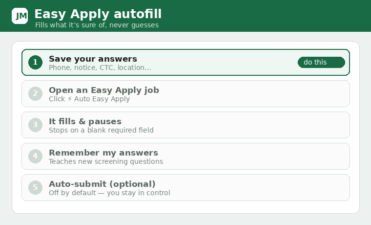

# LinkedIn Easy Apply

An optional **⚡ Auto Easy Apply** button appears on LinkedIn Easy Apply jobs. It fills fields it
can confidently match from your saved answers and **stops rather than guess** when a required field
is blank or unmapped — it never submits an incomplete or fabricated application.

## Saved answers
Set these in **Settings → Easy Apply autofill**: phone, current location, years of experience,
notice period, current/expected CTC, work authorization.

## Auto‑submit (off by default)
A checkbox lets the extension click **Submit** for you. It's **off** by default. When on,
applications are sent immediately and cannot be undone, and heavy automation can get your LinkedIn
account restricted. It still refuses to submit when a required field is blank.

## Remember my answers
When Easy Apply pauses on a **new screening question**, answer it in the dialog, then click
**Remember my answers** on the on‑page card. The extension learns the question→answer mapping and
auto‑fills it next time. Clear everything it learned via **Settings → Clear learned answers**.

> Automating LinkedIn's UI is against their terms of service and carries account risk. It runs only
> on your machine, on your click.
