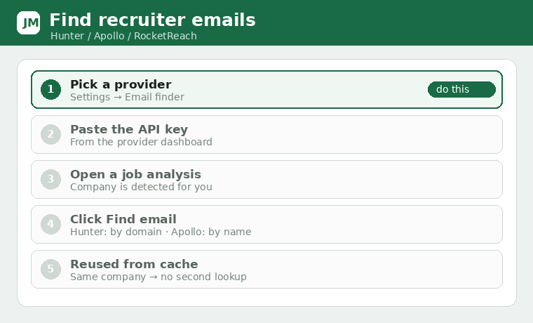

# Email finder (Hunter / Apollo / RocketReach)

Adds a **Find email** button to each analysis. LinkedIn never exposes a poster's address, so this
looks up likely recruiter/company emails. Pick a provider and paste its key in **Settings → Email
finder**.

## Providers
- **Hunter.io** — searches by company **domain or name**; can rank recruiter/HR/talent mailboxes.
  Works without a contact name. Key: <https://hunter.io> → API.
- **Apollo.io** — matches a **specific person**, so fill the hiring‑contact name first. Key from
  your Apollo account's API settings.
- **RocketReach** — also matches a specific person (needs a name). Key from RocketReach API
  settings.

The hiring‑contact name is taken from the job page's "Meet the hiring team / People you can reach
out to" section when present, so Apollo/RocketReach can match a real person.

## Caching
Every successful lookup is cached locally (keyed by provider + company/domain + name). Repeating the
same search returns the stored address instantly — no API call, no quota used. Results are tagged
"(saved from an earlier search)".

## Common errors
- *"No user found for the API key supplied"* (Hunter) — the key is wrong/expired. Re‑copy it, or
  switch provider.
- *"needs the contact first name"* (Apollo/RocketReach) — fill the hiring contact name, or use
  Hunter which can search by domain alone.

Always verify an address before sending.
