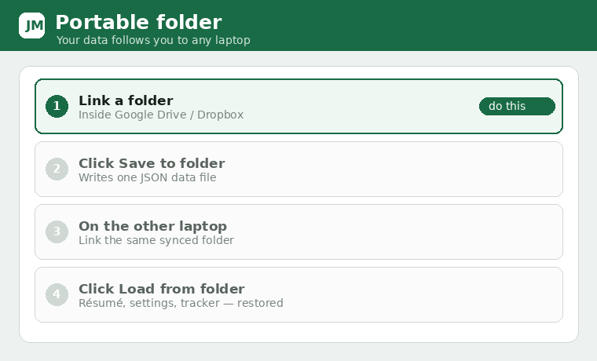

# Portable folder (switch laptops)

Keeps all your extension data in a real folder on disk so it survives a Chrome reinstall or a move
to another laptop. If that folder lives inside **Google Drive / Dropbox / OneDrive**, it travels
between machines automatically.

## Link it (once)
1. Open **Settings → Portable folder (switch laptops)**.
2. Click **Link folder** and pick a folder inside your cloud‑synced directory.
3. Click **Save to folder**. This writes `job-match-assistant-data.json` there.

What's saved: résumé + résumé text, all settings and API keys, the applied‑jobs tracker, learned
Easy Apply answers, and the email cache.

## On another laptop
1. Install the extension and open **Settings**.
2. Link the **same** synced folder.
3. Click **Load from folder** — your data is restored (the page reloads).

## Automatic saves
Once you've granted the folder permission on the Settings page, the extension also saves to the
folder when you save Settings and (best‑effort) when you mark a job applied or change the board
search. The folder **picker** only appears on the full Settings page (a browser rule), but later
saves happen in the background.

> Requires Chrome/Edge on desktop (File System Access API). A daily backup to your Downloads folder
> (`JobMatch/applied-jobs-backup.json`) also exists as a fallback and can be re‑imported with
> **Restore**.
