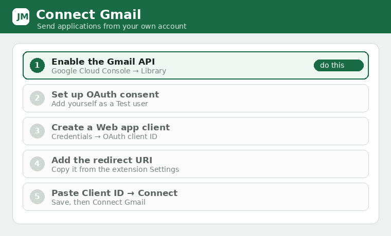

# Gmail sending (OAuth client ID)

Sending and drafting go through your own Gmail using Google OAuth. You create a Google OAuth **Web
application** client once and paste its ID into Settings. The extension cannot mint a Google
credential for you.

## Steps
1. In **Settings**, open the Gmail section and follow the guided wizard, or:
2. Go to the [Google Cloud Console](https://console.cloud.google.com/), create/select a project.
3. **APIs & Services → Library →** enable the **Gmail API**.
4. **APIs & Services → OAuth consent screen →** configure it; add yourself as a **Test user**.
5. **APIs & Services → Credentials → Create credentials → OAuth client ID →** type **Web
   application**.
6. Add the **redirect URI** shown in the extension's Settings (it looks like
   `https://<extension-id>.chromiumapp.org/`). Copy it exactly from Settings.
7. Copy the issued **Client ID**, paste it into Settings, and click **Save Gmail client ID**.
8. Click **Connect Gmail** and complete Google's consent.

## Scopes used
- `gmail.send` — send/draft the application email
- `gmail.readonly` — read job‑alert emails for the inbox feature
- `userinfo.email` — show which account is connected

## Notes
- Use a **Web application** client (not "Chrome extension"). Older Chrome‑extension clients won't
  work with this flow.
- Tokens are short‑lived (~1 hour, no refresh token); reconnect when they expire.
- Don't change the extension's folder/ID after setup — it changes the redirect URI.
- Sending is always **review‑then‑confirm**: only the exact message shown is sent.
