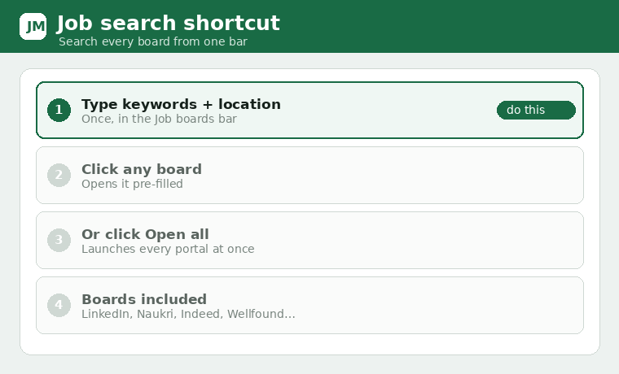

# Job search shortcut

The popup's **Job boards** section has one search bar that drives every portal.

1. Type your **keywords** and **location** once in the bar.
2. Click any board to open it **pre-filled**, or click **Open all** to launch them all.
3. Boards: LinkedIn, Wellfound, Instahyre, Naukri, Indeed, Glassdoor, Cutshort, Hirist, Foundit,
   Work at a Startup, RemoteOK, Remote.co.

Real embedding of job portals isn\'t possible (they block being shown in a frame), so each opens in
its own tab, already searched. Your keywords/location are remembered.
